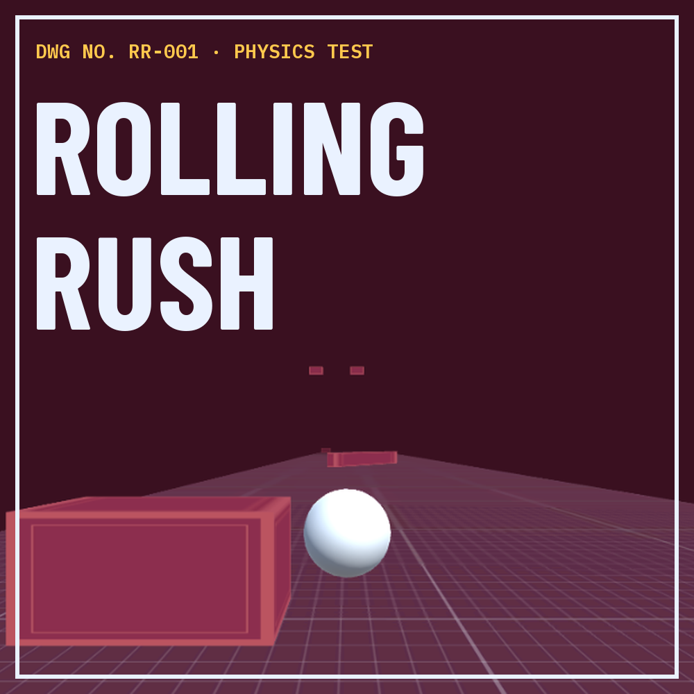

# Rolling Rush



A short 3D physics dodging game styled as an engineering blueprint. Steer a ball through three "test sheets", each adding a new hazard, and set your best distance.

**[▶ Play in browser on itch.io](https://chloludev.itch.io/rolling-rush)** · Windows download available on the same page

---

## About this project

Rolling Rush started from [Brackeys' Unity tutorial](https://www.youtube.com/@Brackeys). I then extended it with my own systems, UI and content:

- **Blueprint UI redesign:** every screen (menu, HUD, pause, game over, level complete, credits) rebuilt in a consistent engineering-drawing style with 9-slice outlined components
- **Data-driven levels:** each level is a `LevelSettings` ScriptableObject holding its name, physics, length, difficulty, obstacle mix and visual theme
- **Obstacle spawner:** builds a random layout every run, always leaving at least one gap per row
- **4 new obstacle types:** sliders, gates, spinning sweepers, and drop blocks with shadow warnings
- **Per-level themes:** track, obstacles, sky and fog colour applied at runtime from level data
- **Game state & saving:** `Playing / Paused / Won / Lost` state machine, pause menu, game over report, and per-level best distance saved with `PlayerPrefs`
- **Audio:** a persistent singleton `AudioManager` with scene-aware music volume, smooth fades and ducking on pause and result screens
- **Controls:** keyboard plus touch / mouse steering (hold left or right half of the screen)
- **Polish:** stamp-slam animation, physics-style rolling ball on the menu, blinking hazard callouts

## Controls

| Action | Input |
|---|---|
| Steer | `A` / `D`, or hold the left / right half of the screen |
| Pause | `Esc` or the pause button |

## Project structure

```
Assets/
├── Scripts/
│   ├── GameManager.cs       # game state, pause, game over, level complete, best score
│   ├── LevelSettings.cs     # ScriptableObject: per-level data
│   ├── Data/                # Level1/2/3Settings assets
│   ├── ObstacleSpawner.cs   # random layout generation from level data
│   ├── Slider.cs / Sweeper.cs / Drop.cs   # obstacle behaviours
│   ├── LevelTheme.cs        # applies materials, sky and fog per level
│   ├── PlayerMovement.cs    # input in Update, physics in FixedUpdate
│   ├── AudioManager.cs      # singleton music + SFX manager
│   └── ...                  # menu, UI and animation helpers
├── Prefabs/                 # Player, LevelUI, obstacles, AudioManager
├── Scenes/                  # Menu, DodgeZone (L1–L3), Credits
└── Material/Blueprint/      # textures and materials (made in Figma)
```

## Running the project

1. Install **Unity 2022.3 LTS** (made with 2022.3.62f2).
2. Clone this repo and open it in Unity Hub (**Add → Add project from disk**).
3. Open `Assets/Scenes/Menu` and press Play.

Editor-only debug keys: `F1` complete level · `F2` game over · `F3` screenshot.

## Credits

- **Base:** Brackeys' Unity tutorial
- **Design & code extensions:** chloludev
- **Sound effects:** [Kenney](https://kenney.nl) (CC0)
- **Music:** "Background Minimal Acid Electronic – Drum And Bass" by Musinova ([Pixabay](https://pixabay.com))
- **Fonts:** Barlow Condensed, IBM Plex Mono (SIL Open Font License)
- AI assistance was used for code guidance; design decisions and implementation are my own.
